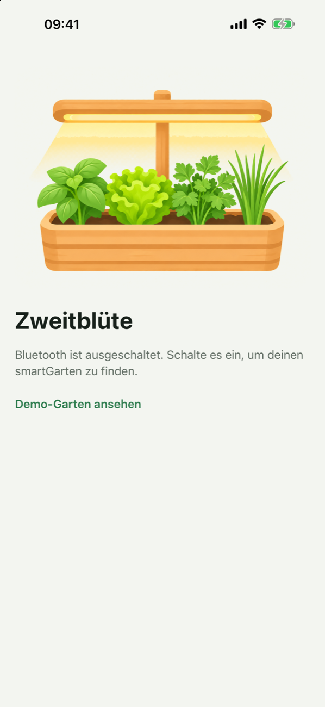
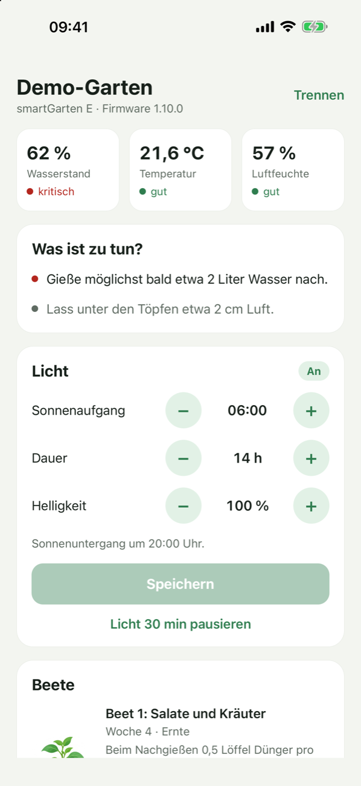
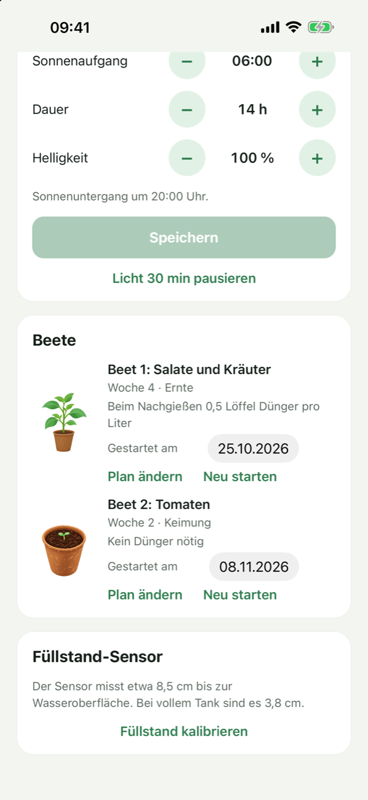
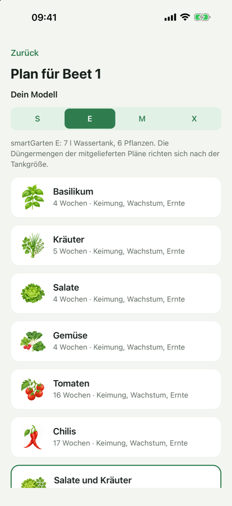
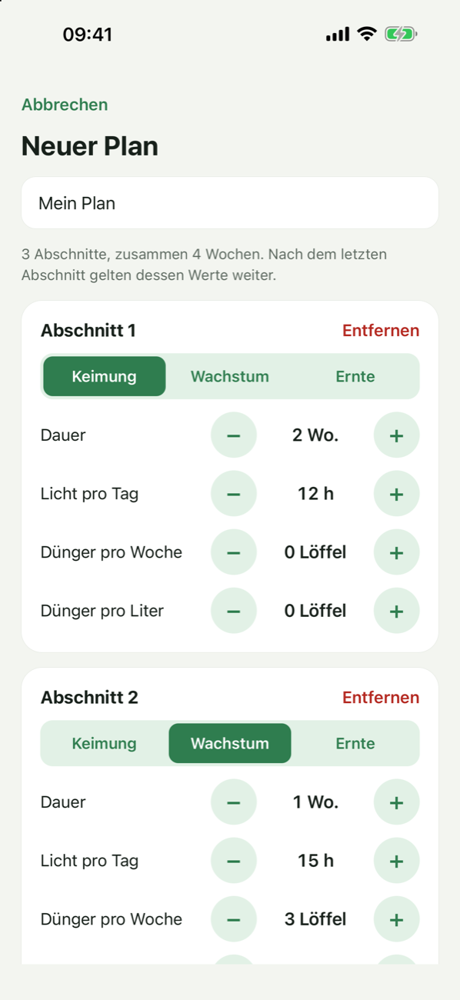

# Zweitblüte

Eine freie App für den **smartGarten** von simplePlant. Der Hersteller wurde
aufgelöst, die Original-App ist aus den Stores verschwunden, und ohne App
lassen sich Licht und Beete nicht mehr einstellen. Zweitblüte spricht direkt
per Bluetooth mit dem Gerät und braucht weder Konto noch Server.

*An open-source replacement app for the simplePlant smartGarten indoor garden,
whose vendor shut down. It talks to the device over Bluetooth LE, with no
account and no server. The app is available in German and English; this
documentation is in German.*

<p>
  
  
  
  
  
</p>

Die Bilder zeigen den eingebauten Demo-Garten im iOS-Simulator. Dort gibt es
kein Bluetooth, deshalb der Hinweis auf dem ersten Bild.

Zweitblüte ist ein inoffizielles Community-Projekt und steht in keiner
Verbindung zur simplePlant GmbH oder ihren Rechtsnachfolgern. Die App ist noch
nicht in den App-Stores; im Moment muss man sie selbst bauen.

## Für wen ist das?

Für alle, die einen smartGarten S, E, M oder X besitzen. Das Gerät läuft auch
ohne App weiter, aber nur mit dem zuletzt eingestellten Lichtplan, und seine
Uhr verstellt sich mit der Zeit. Ohne App lässt sich weder der Lichtplan
ändern noch ein neues Beet starten.

Getestet ist die App bisher mit einem einzigen Gerät: einem smartGarten mit
Firmware 1.10.0 an einem iPhone. Dessen Nährstoffsensor liefert keine Werte,
dieser Teil ist deshalb ungeprüft. Für andere Modelle und
Firmware-Versionen sind Rückmeldungen willkommen.

## Was die App kann

### Garten finden und verbinden

Die App sucht nach Gärten in der Nähe und verbindet auf Fingertipp. Den zuletzt
verbundenen Garten findet sie beim nächsten Start von selbst wieder. Bei jeder
Verbindung stellt sie die Uhr des Geräts, damit der Lichtplan zur Ortszeit
passt. Der smartGarten lässt nur eine Verbindung gleichzeitig zu.

Wer kein Gerät hat oder die App erst ansehen möchte, tippt auf
„Demo-Garten ansehen“.

### Sensorwerte mit Ampel

Wasserstand, Lufttemperatur und Luftfeuchte werden alle fünf Sekunden
aktualisiert. Ein farbiger Punkt zeigt, ob der Wert für das aktuelle
Pflanzenprogramm und die aktuelle Woche gut, grenzwertig oder kritisch ist.

### Was ist zu tun?

Aus Messwerten, Lichtplan und Pflanzenprogramm leitet die App ab, was gerade
ansteht:

- wie viel Wasser nachzugießen oder zu entnehmen ist,
- wie viele Löffel Dünger fehlen, wenn der Nährstoffsensor einen Wert liefert,
- worauf beim Wasser in der aktuellen Phase zu achten ist,
- ob Lichtdauer oder Helligkeit von der Empfehlung abweichen.

### Licht

Sonnenaufgang, Dauer und Helligkeit lassen sich einstellen; den Sonnenuntergang
rechnet die App aus. Mit „Licht 30 min pausieren“ geht die Lampe sofort aus und
danach von selbst wieder an.

### Beete und Pflanzenprogramme

Der smartGarten hat zwei Beete. Für jedes zeigt die App Programm, Woche, Phase,
ein Fortschrittsbild und den Düngerhinweis für die aktuelle Woche. Ein Beet
lässt sich starten, neu starten, leeren oder im Startdatum korrigieren.

Mitgeliefert sind die acht Programme der Original-App:

| Programm | Dauer | Phasen |
|---|---|---|
| Basilikum | 4 Wochen | Keimung, Wachstum, Ernte |
| Kräuter | 5 Wochen | Keimung, Wachstum, Ernte |
| Salate | 4 Wochen | Keimung, Wachstum, Ernte |
| Gemüse | 4 Wochen | Keimung, Wachstum, Ernte |
| Tomaten | 16 Wochen | Keimung, Wachstum, Ernte |
| Chilis | 17 Wochen | Keimung, Wachstum, Ernte |
| Salate und Kräuter | 4 Wochen | Keimung, Wachstum, Ernte |
| Allgemein | 4 Wochen | Keimung, Wachstum, Ernte |

Nach der letzten Woche gelten die Werte der Erntephase weiter. Die
Düngermengen richten sich nach dem Modell, das man in der Planauswahl angibt:
der smartGarten S hat einen 3,5-Liter-Tank, E, M und X haben 7 Liter.

### Eigene Pläne

Weil es vom Hersteller keine neuen Programme mehr geben wird, lassen sich
eigene anlegen: beliebig viele Abschnitte, je mit Phase, Dauer in Wochen,
Lichtstunden pro Tag und Düngermenge pro Woche oder pro Liter beim Nachgießen.
Eigene Pläne bleiben auf dem Telefon; im Gerät wird dafür das Programm
„Allgemein“ hinterlegt.

### Füllstand-Sensor kalibrieren

Die App zeigt, welchen Abstand der Sensor bis zur Wasseroberfläche misst, und
kann ihn neu kalibrieren. Das Gerät übernimmt dabei den aktuellen Stand als
„voll“, deshalb gehört der Tank vorher ganz aufgefüllt.

### Erinnerung

Auf Wunsch erinnert das Telefon eine Woche nach der letzten Verbindung daran,
nach dem Garten zu sehen. Die App erfährt den Zustand des Gartens nur, solange
sie verbunden ist; die Erinnerung richtet sich deshalb nach der Zeit und nicht
nach dem Wasserstand.

## Stand

| Funktion | Stand |
|---|---|
| Garten finden und verbinden, Uhr stellen | am Gerät bestätigt |
| Wasserstand, Temperatur, Luftfeuchte mit Ampel | am Gerät bestätigt |
| Licht: Sonnenaufgang, Dauer, Helligkeit | am Gerät bestätigt |
| Licht 30 Minuten pausieren | am Gerät bestätigt |
| Beet starten, neu starten, leeren, Startdatum ändern | eingebaut, am echten Gerät noch nicht ausgelöst |
| Füllstand kalibrieren | eingebaut, am echten Gerät noch nicht ausgelöst |
| Die acht Original-Pflanzenprogramme mit Phasen | eingebaut |
| Eigene Pflanzenpläne | eingebaut |
| Empfehlungen zu Wasser und Licht | eingebaut |
| Erinnerung nach einer Woche ohne Verbindung | eingebaut, noch nicht auf einem Gerät geprüft |
| Zuletzt verbundenen Garten automatisch wiederfinden | eingebaut, noch nicht auf einem Gerät geprüft |
| Demo-Garten ohne Gerät | eingebaut |
| Android | vorbereitet, noch nicht gebaut oder getestet |
| Sensorbalken v1/v2 wählen | eingebaut, am echten Gerät noch nicht ausgelöst |
| Nährstoffsensor mit Düngerempfehlung | eingebaut; mit echtem Messwert noch nicht geprüft |
| Firmware-Update | fehlt |
| Deutsch und Englisch, je nach Sprache des Telefons | eingebaut; auf Android noch nicht geprüft |

Die vollständige Gegenüberstellung mit der Original-App steht in
[docs/protocol.md](docs/protocol.md).

## Gut zu wissen

- **Kein Pairing:** Der smartGarten verlangt keine Kopplung. Jedes Gerät in
  Bluetooth-Reichweite kann seine Werte lesen und seine Einstellungen ändern.
  Das liegt an der Firmware und lässt sich von der App aus nicht ändern.
- **Keine Daten nach außen:** Die App hat kein Konto, spricht mit keinem
  Server und enthält keine Analyse- oder Werbedienste. Details in
  [PRIVACY.md](PRIVACY.md).
- **Liter und Löffel:** Die Mengen rechnet die App mit den Formeln der
  Original-App aus Füllstand und Nährstoffwert. Liefert der Nährstoffsensor
  keinen Wert, gelten die Düngermengen je Phase.

## So funktioniert es technisch

Der smartGarten ist ein ESP32 mit eigener Firmware. Er bietet einen einzigen
Bluetooth-LE-Dienst mit zwölf Characteristics an: Firmware-Version, Beet-Info,
Sensorwerte, Lichtplan, Uhrzeit, Kalibrierung, Sensor-Konfiguration und
Firmware-Update. Die gesamte Auswertung – Ampel, Empfehlungen,
Pflanzenprogramme – fand schon in der Original-App statt und nicht im Gerät.
Deshalb lässt sich die App vollständig ersetzen.

Das Protokoll ist in [docs/protocol.md](docs/protocol.md) beschrieben, jeweils
mit dem Beleg: am Gerät gemessen, aus der Firmware gelesen oder noch Annahme.

## Aufbau des Repositorys

| Ordner | Inhalt |
|---|---|
| `app/` | Die App (Expo, React Native, TypeScript) |
| `docs/protocol.md` | Das rekonstruierte Bluetooth-Protokoll und wie jeder Teil belegt ist |
| `docs/image-prompts.md` | Prompts, mit denen die Illustrationen erzeugt wurden |
| `docs/screenshots/` | Die Bilder in diesem README |
| `tools/` | Python-Skripte zum Scannen, Auslesen und Testen am Gerät sowie zum Aufbereiten von Daten und Bildern |
| `captures/` | Mitschnitte der Tests am echten Gerät |
| `images/` | Die Quellbilder der Illustrationen |

## App bauen

Voraussetzungen: Node.js 20 oder neuer, für iOS Xcode und CocoaPods, für
Android das Android SDK. Bluetooth funktioniert weder in Expo Go noch im
iOS-Simulator; dort lässt sich nur der Demo-Garten nutzen.

```bash
cd app
npm install
npm test
npx expo run:ios      # Simulator, nur Demo-Garten
```

Für ein echtes iPhone die eigene Apple-Team-ID in `app/.env.local` eintragen
(`APPLE_TEAM_ID=XXXXXXXXXX`) und dann:

```bash
npx expo run:ios --device --configuration Release
```

## Werkzeuge für das Gerät

Die Skripte in `tools/` brauchen [uv](https://docs.astral.sh/uv/) und einen
Rechner mit Bluetooth. Unter macOS muss das Terminal Bluetooth nutzen dürfen.

```bash
uv run tools/ble_scan.py          # Geräte in der Nähe auflisten
uv run tools/ble_dump.py          # GATT-Tabelle lesen und Notifications mithören
uv run tools/ble_set_time.py      # Geräteuhr stellen
```

`ble_light_test.py`, `ble_light_seq.py` und `ble_snooze_test.py` schreiben auf
das Gerät und stellen danach den vorherigen Wert wieder her.

## Herkunft der Daten

- **Protokoll:** durch Auslesen eines eigenen Geräts und Analyse der zuletzt
  ausgelieferten Original-App und ihrer Firmware rekonstruiert, ausschließlich
  um das Gerät weiter nutzen zu können. Original-App und Firmware liegen nicht
  in diesem Repository.
- **Pflanzenprogramme:** `app/src/plants/programs.json` enthält die Werte der
  Pflanzen-Datenbank der Original-App (Wochen, Lichtstunden, Düngermengen,
  Grenzwerte), damit vorhandene Geräte sich wie gewohnt verhalten.
- **Illustrationen:** mit einem Bildgenerator neu erstellt; aus der
  Original-App stammen keine Grafiken.

Näheres in [NOTICE.md](NOTICE.md).

## Mitmachen

Besonders hilfreich sind Tests mit anderen Modellen (S, M, X) und anderen
Firmware-Versionen. Ein Mitschnitt von `tools/ble_dump.py` in einem Issue
reicht oft schon, um eine Lücke im Protokoll zu schließen.

## Lizenz

[GPL-3.0-or-later](LICENSE). Die Datenschutzerklärung steht in
[PRIVACY.md](PRIVACY.md).
